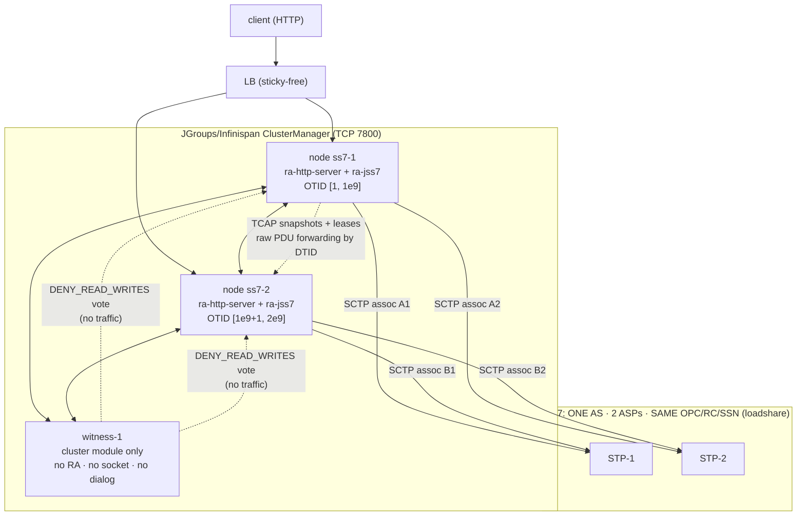
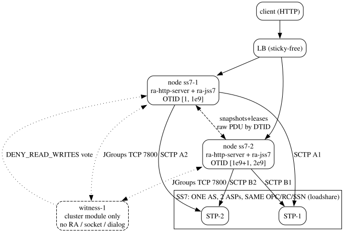

# Clustering design — true active/active (ADR 0007 target architecture)

- **Status:** design doc for the lab in `docs/lab/active-active-two-node.md`.
  P0–P3 ship in-process; no active/active claim is valid until lab P6 passes.
- **Related:** [ADR 0001](adr/0001-ss7-ra-nn-tcap-failover.md) ·
  [ADR 0002](adr/0002-ra-sticky-ha-fabric.md) ·
  [ADR 0007](adr/0007-true-active-active.md)

## Target architecture

Two symmetric nodes. Each node terminates its **own** SCTP association to
**both** STPs (4 associations total), under the **same AS** with the same
OPC/RC/SSN in loadshare mode. An SBB always sends through its **own** SS7 stack,
so the node that owns the TCAP dialog is also the node holding the client's
HTTP connection.

When the STP load-shares a CONTINUE/END/ABORT onto the **other** ASP, that node
sees a DTID outside its own OTID range and forwards the **raw PDU** to the owner
(`ss7_tcap_foreign_pdu_forwarded_total`), which processes it with its own stack.
Nothing decoded crosses the cluster. Takeover is **lazy**: only when traffic for
a dialog arrives whose owner left the view (lease CAS, `gen + 1`); a partitioned
but alive zombie is fenced (`mayTransmit()` refuses, counted in `fenceBlocked`).
Unrecoverable dialogs (pending invokes never captured, legacy payload) are
**droppable**: the survivor answers P-Abort `UnrecognizedTxID` and the client
retries with the same `activityId` (HTTP-only external plane — a parked request
dies with its node, §5 of the lab doc).

Rendered diagrams (Graphviz, generated from the `.dot` next to this file —
`mmdc`/`plantuml` are not installed; mermaid above is the source of truth):

- 
- PNG: `docs/clustering-design.png` (binary, same render at 2x)

## Cache plane (all on the one `ClusterManager`, never a second fabric)

| Cache | Mode | Content |
|-------|------|---------|
| `ra-<name>-lease` | `REPL_SYNC` + `DENY_READ_WRITES` | `RaDialogLease` (claim-before-send, heartbeat, lazy takeover) |
| `tcap-dialog-snapshot` | `REPL_SYNC` | `TcapDialogSnapshotPayload` (+ app correlation id) |
| `tcap-dialog-meta` / `tcap-dialog-by-remote` | `REPL_SYNC` | dialog meta + remote index |
| `ra-jss7-sticky-cmd` | `DIST_SYNC` | P1 sticky outbound commands |
| `slee-timer-deadlines` | `REPL_SYNC` | absolute timer deadlines, firing guarded by the dialog lease |
| `map-app-correlation` | `REPL_SYNC` | app correlation id → OTID (multi-step MAP rehydrate) |
| `sctp-endpoint-lease` | `REPL_SYNC` | n-n endpoint / VIP fence |

## Node symmetry (D11) checklist

1. One AS, both ASPs, same OPC/RC/SSN — otherwise the survivor never sees CONTINUE.
2. Disjoint OTID ranges (`dialogIdRangeStart/End`); cluster mode refuses to start without one.
3. `channel: "sctp"` everywhere — never TCP.
4. Separate SCCP stack per node (`registerSccpListener` collides on SSN).
5. Witness on a third host — two members cannot form a majority.
6. Client retries with the same `activityId`.
7. NTP on all hosts.
